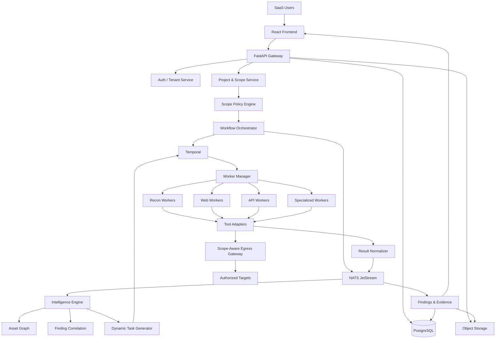

# FFUF Online
## SaaS + Hybrid Autonomous Bug Bounty Intelligence Platform

**Document type:** Technical Architecture & Implementation Specification  
**Project:** FFUF Online  
**Architecture:** Multi-tenant SaaS + Hybrid Distributed Execution  
**Primary objective:** Build an integrated bug bounty platform where security tools exchange findings, generate dependent tasks, correlate evidence, and continuously improve the target's attack-surface intelligence.

---

# 1. Product Vision

FFUF Online is not a conventional vulnerability scanner or a graphical wrapper around existing CLI tools.

It is a modular, event-driven security testing platform that orchestrates specialized tools through a shared intelligence layer.

The platform must support the following lifecycle:

1. A user creates an account and organization.
2. The user creates a bug bounty project.
3. The user defines the authorized targets, exclusions, and testing policies.
4. The platform validates the scope.
5. Reconnaissance tools discover assets and endpoints.
6. Every result is normalized and stored.
7. The Intelligence Engine evaluates new information.
8. Relevant downstream tools receive automatically generated tasks.
9. New results are correlated with existing assets and findings.
10. The platform prioritizes potential vulnerabilities.
11. Evidence is validated using safe, non-destructive verification.
12. The user receives findings and report-ready evidence.

The platform must operate as a continuous feedback system rather than a fixed sequence of scans.

## 1.1 Core principles

- Multi-tenant isolation.
- Event-driven architecture.
- Dependency-aware orchestration.
- Modular tool adapters.
- Dynamic workflow generation.
- Persistent execution state.
- Scope enforcement before every network operation.
- Evidence-based findings.
- Human approval for sensitive testing.
- Horizontal worker scalability.
- Full auditability.

# 2. Architecture Overview

The system consists of three primary planes.

## 2.1 Control Plane

Responsible for managing the SaaS platform.

Components:

- Authentication and authorization.
- Tenant and organization management.
- Subscription and billing.
- Project management.
- Bug bounty program management.
- Scope management.
- Scan configuration.
- Workflow management.
- Task scheduling.
- Finding management.
- Dashboard and reporting.
- Administrative controls.

The Control Plane must not directly execute arbitrary scanning commands.

## 2.2 Execution Plane

Responsible for running external security tools.

Components:

- Worker Manager.
- Worker Agent.
- Docker execution runtime.
- Tool Registry.
- Tool Adapters.
- Network Egress Gateway.
- Result Parser.
- Artifact Collector.

Workers can run on platform-managed infrastructure or customer-managed infrastructure.

Execution models:

**Platform-managed workers**
- Hosted by FFUF Online.
- Automatically provisioned.
- Isolated execution environments.
- Suitable for ordinary public bug bounty programs.

**Customer-managed workers**
- Installed in the customer's infrastructure.
- Connect outbound to the Control Plane.
- Pull authorized tasks.
- Execute tools locally.
- Return normalized results.
- Do not expose inbound management ports.

**Dedicated workers**
- Optional isolated compute for individual tenants.
- Suitable for customers requiring stronger infrastructure separation.

## 2.3 Intelligence Plane

This is the core differentiating component.

Components:

- Event Processor.
- Asset Intelligence Engine.
- Asset Relationship Graph.
- Finding Correlation Engine.
- Dependency Resolver.
- Dynamic Task Generator.
- Risk Prioritization Engine.
- Feedback Engine.
- Workflow Policy Engine.

The Intelligence Plane determines which tool should run next and why.

# 3. High-Level System Architecture



# 4. Recommended Technology Stack

| Component | Technology | Responsibility |
|---|---|---|
| Frontend | React + TypeScript | SaaS dashboard |
| UI | Tailwind CSS + shadcn/ui | Interface |
| Backend | Python + FastAPI | Application API |
| Authentication | Auth.js or managed OIDC provider | Authentication |
| Authorization | RBAC + tenant context | Access control |
| Main database | PostgreSQL | Persistent data |
| Database isolation | PostgreSQL RLS | Tenant isolation |
| Workflow engine | Temporal | Durable orchestration |
| Event bus | NATS JetStream | Event distribution |
| Cache | Redis | Cache and ephemeral state |
| Object storage | S3-compatible storage | Scan artifacts and evidence |
| Execution | Docker | Isolated tool execution |
| Worker communication | HTTPS + mTLS | Secure worker connections |
| Monitoring | OpenTelemetry | Observability |
| Metrics | Prometheus | System metrics |
| Dashboards | Grafana | Infrastructure monitoring |
| Deployment | Docker Compose initially | MVP deployment |
| Future orchestration | Kubernetes | Distributed scaling |

Temporal and NATS have different responsibilities.

Temporal handles durable workflows, retries, cancellation, and long-running execution state.

NATS JetStream distributes domain events and allows consumers to process persisted events independently.

PostgreSQL remains the authoritative source of business data.

# 5. Multi-Tenant SaaS Architecture

This is one of the most important parts of the system.

Every customer must operate inside an isolated tenant context.

## 5.1 Hierarchy

```text
Platform
│
├── Tenant A
│   ├── Organization
│   ├── Users
│   ├── Projects
│   │   ├── Program 1
│   │   ├── Program 2
│   │   └── Program 3
│   ├── Assets
│   ├── Scans
│   └── Findings
│
├── Tenant B
│   ├── Organization
│   ├── Users
│   ├── Projects
│   ├── Assets
│   └── Findings
│
└── Platform Administration
```

## 5.2 Roles

Platform roles:

- Super Admin.
- Platform Security Administrator.
- Support Administrator.

Tenant roles:

- Organization Owner.
- Organization Admin.
- Security Researcher.
- Analyst.
- Read-only User.

Permissions must be explicit and enforced server-side.

A tenant administrator must never receive platform-wide access merely because they have administrative permissions inside their organization.

## 5.3 Tenant isolation requirements

Every tenant-owned database record must be associated with a tenant.

Required protections:

- Tenant context derived from authenticated identity.
- PostgreSQL Row-Level Security.
- Tenant-aware API authorization.
- Tenant-aware object storage paths.
- Tenant-aware cache keys.
- Tenant-aware queue metadata.
- Tenant-specific execution quotas.
- Tenant-specific rate limits.
- Tenant-specific audit records.
- Tenant-scoped idempotency and deduplication.

Use composite foreign keys where appropriate to prevent records from referencing resources belonging to another tenant.

Never trust a tenant ID supplied by the frontend without verifying it against the authenticated user's memberships.

Use transaction-local database tenant context with pooled connections and test connection reuse carefully.

# 6. Hybrid Worker Architecture

## 6.1 Worker types

Create separate worker categories.

| Worker | Responsibilities |
|---|---|
| Recon Worker | Subdomain and DNS enumeration |
| HTTP Worker | HTTP probing and crawling |
| Content Worker | Directory and file discovery |
| API Worker | API discovery and parameter analysis |
| Vulnerability Worker | Safe vulnerability checks |
| Network Worker | Authorized service discovery |
| Code Analysis Worker | Source code security tools |
| Validation Worker | Evidence validation |
| Report Worker | Report generation |

The worker manager must select workers based on:

- Tool requirements.
- Resource requirements.
- Tenant execution plan.
- Network location.
- Tool availability.
- Worker health.
- Job priority.

## 6.2 Worker lifecycle

```text
Worker starts
    ↓
Authenticate with Control Plane
    ↓
Register capabilities
    ↓
Receive authorized task
    ↓
Verify task signature and scope policy
    ↓
Create isolated execution container
    ↓
Execute approved tool
    ↓
Collect output and artifacts
    ↓
Normalize results
    ↓
Submit results to Control Plane
    ↓
Destroy execution environment
    ↓
Request next task
```

## 6.3 Worker security

Every execution container must use:

- Non-root user.
- Read-only filesystem where practical.
- Dropped Linux capabilities.
- Seccomp profile.
- CPU and memory limits.
- Execution timeout.
- Restricted writable directories.
- No privileged mode.
- No host Docker socket.
- No host filesystem mounting.
- No unrestricted network access.

Worker agents must not accept arbitrary shell commands from users.

Tool execution must use structured arguments and allowlisted options.

A tenant must not be able to escape the tool adapter and execute arbitrary commands on a worker host.

## 6.4 Worker authentication

Use short-lived worker credentials and mutual TLS.

Every job must contain:

- Job ID.
- Tenant ID.
- Project ID.
- Scope version.
- Policy version.
- Tool identifier.
- Tool version.
- Structured input.
- Execution limits.
- Expiration timestamp.
- Idempotency key.

The worker must verify the job's authenticity and validity before execution.

# 7. Scope Enforcement Engine

Scope enforcement is a security-critical component, not a normal filter.

No active network task may be executed without an approved scope decision.

## 7.1 Scope types

Support:

- Exact domains.
- Wildcard domains.
- Exact hostnames.
- IP addresses.
- CIDR ranges.
- URL prefixes.
- Explicit exclusions.
- Program-specific restrictions.

## 7.2 Scope validation pipeline

```text
Task generated
    ↓
Resolve target identity
    ↓
Check project authorization
    ↓
Check scope inclusion
    ↓
Check explicit exclusions
    ↓
Check DNS resolution
    ↓
Check destination IP
    ↓
Check redirect destination
    ↓
Check execution policy
    ↓
Approve or reject
```

Revalidate every redirect and every new hostname before connecting.

Protect against DNS rebinding and unexpected CNAME resolution.

Block private, loopback, link-local, reserved, and cloud metadata destinations by default.

Only explicitly authorized public targets should be reachable through the scan egress gateway.

The gateway must enforce destination policy independently of the worker.

## 7.3 Authorization records

A project must contain:

- Program name.
- Program platform or source.
- Authorization evidence.
- Authorized domains and IP ranges.
- Explicit exclusions.
- Allowed test categories.
- Prohibited test categories.
- Maximum request rate.
- Maximum concurrency.
- Testing time window.
- Authorization expiration.
- Scope version.
- User confirmation.

Require re-approval when the scope or policy materially changes.

## 7.4 Safe execution profiles

Initial profiles:

**Passive**
- Public DNS information.
- Historical URL collection.
- Passive asset intelligence.
- No active probing.

**Low-impact discovery**
- HTTP probing.
- Crawling.
- Controlled content discovery.
- Conservative rate limits.

**Authorized vulnerability testing**
- Non-destructive vulnerability checks.
- Approved parameter testing.
- Safe API testing.
- Human approval for sensitive operations.

Do not provide autonomous destructive exploitation, denial-of-service testing, uncontrolled brute force, or data modification.

# 8. Tool Registry and Adapter Architecture

Every external tool must be registered through a standardized adapter interface.

## 8.1 Tool registry

Each tool registration must define:

```json
{
  "tool_id": "ffuf",
  "name": "FFUF",
  "category": "content_discovery",
  "version": "pinned-version",
  "image": "registry/ffuf",
  "input_schema": {},
  "output_schema": {},
  "capabilities": [
    "directory_discovery",
    "file_discovery",
    "parameter_fuzzing"
  ],
  "required_inputs": [
    "authorized_base_url",
    "wordlist"
  ],
  "resource_profile": {
    "cpu": "low",
    "memory": "low"
  },
  "network_profile": "controlled_http",
  "enabled": true
}
```

Tool versions and container images must be pinned.

Maintain checksums, source repository, license, SBOM, and update history.

Do not install or update arbitrary tools dynamically during a scan.

## 8.2 Adapter interface

```python
from abc import ABC, abstractmethod


class BaseToolAdapter(ABC):

    tool_id: str
    tool_version: str

    @abstractmethod
    def validate_input(self, task):
        pass

    @abstractmethod
    def build_arguments(self, task):
        pass

    @abstractmethod
    def execute(self, task):
        pass

    @abstractmethod
    def parse_output(self, output):
        pass

    @abstractmethod
    def normalize_results(self, parsed_output):
        pass

    @abstractmethod
    def get_capabilities(self):
        pass
```

All adapters must implement the same contract.

Use argument arrays rather than shell-string interpolation.

Never construct shell commands by concatenating user-controlled input.

## 8.3 Initial tool integrations

### Reconnaissance

- BBOT
- Amass
- Subfinder
- DNSx
- HTTPx
- Naabu
- Katana
- GAU

### Content discovery

- FFUF
- Feroxbuster
- Gobuster
- Dirsearch
- Wfuzz

### API discovery

- Kiterunner
- Arjun
- x8
- ParamSpider
- JSluice
- LinkFinder

### Web vulnerability testing

- Nuclei
- Dalfox
- SQLmap
- Ghauri
- SSTImap
- SSRFmap
- JWT Tool

### Advanced testing

- Burp Suite integration
- Caido integration
- Turbo Intruder
- Param Miner
- HTTP Request Smuggler
- Schemathesis
- RESTler
- GraphQLmap

### Network and infrastructure

- Nmap
- RustScan
- Greenbone/OpenVAS
- testssl.sh

### Source code and cloud

- Semgrep
- CodeQL
- Trivy
- Prowler
- ScoutSuite
- CloudFox

The initial tool inventory should follow the existing ethical hacking and bug bounty arsenal document. Not all tools should be activated in the first release.

Some desktop applications, such as Burp Suite and Caido, require a different integration model from headless CLI tools. Initially support export/import or an explicitly configured integration API. Do not assume every desktop tool can run as a normal Docker worker.

# 9. Shared Data Model

All adapters must convert their output into common data structures.

## 9.1 Core entities

- Tenant
- User
- Membership
- Organization
- Project
- Program
- AuthorizationEvidence
- ScopeRule
- ScopeVersion
- Asset
- Endpoint
- Service
- Technology
- Parameter
- Tool
- ToolVersion
- ToolExecution
- Workflow
- WorkflowNode
- Task
- Event
- Finding
- Evidence
- Relationship
- Report
- AuditLog
- Worker
- Subscription
- UsageRecord

## 9.2 Core PostgreSQL tables

```text
tenants
users
tenant_memberships
organizations
projects
programs
authorization_evidence
scope_rules
scope_versions

assets
asset_relationships
services
endpoints
endpoint_parameters
technologies

tool_registry
tool_versions
tool_capabilities
tool_executions

workflows
workflow_nodes
tasks
task_dependencies
task_attempts

domain_events
findings
finding_evidence
finding_relationships

workers
worker_capabilities
worker_heartbeats

reports
audit_logs
subscriptions
usage_records
```

Every tenant-owned table must include tenant ownership and appropriate database-level constraints.

## 9.3 Asset schema

```json
{
  "id": "asset-001",
  "tenant_id": "tenant-001",
  "project_id": "project-001",
  "asset_type": "subdomain",
  "value": "api.example.com",
  "parent_asset_id": "asset-root-001",
  "source_tools": [
    "subfinder",
    "amass"
  ],
  "scope_status": "in_scope",
  "confidence": 0.98,
  "first_seen_at": "2026-11-11T10:00:00Z",
  "last_seen_at": "2026-11-11T10:00:00Z"
}
```

## 9.4 Finding schema

```json
{
  "id": "finding-001",
  "tenant_id": "tenant-001",
  "project_id": "project-001",
  "asset_id": "asset-001",
  "endpoint": "/api/users",
  "finding_type": "potential_access_control_issue",
  "title": "Potential authorization weakness",
  "severity": "unknown",
  "confidence": 0.75,
  "status": "needs_validation",
  "source_tools": [
    "katana",
    "nuclei"
  ],
  "evidence_ids": [],
  "related_finding_ids": [],
  "scope_version": 3
}
```

A discovered endpoint is not automatically a vulnerability.

Keep these concepts separate:

- Asset discovery.
- Potential issue.
- Validated vulnerability.
- Confirmed impact.
- Report-ready finding.

# 10. Event-Driven Intelligence Engine

This is the core of FFUF Online.

## 10.1 Event flow

Example event names:

```text
asset.discovered
asset.updated
dns.record.discovered
http.service.discovered
http.endpoint.discovered
http.redirect.discovered
api.endpoint.discovered
api.schema.discovered
parameter.discovered
technology.detected

tool.execution.started
tool.execution.completed
tool.execution.failed

finding.candidate.created
finding.evidence.added
finding.validated
finding.rejected

scope.changed
scope.expired
task.created
task.cancelled
```

Every event must include:

- Event ID.
- Tenant ID.
- Project ID.
- Event type.
- Source tool.
- Source execution ID.
- Asset reference.
- Scope version.
- Timestamp.
- Schema version.
- Payload.

## 10.2 Event-driven execution

Example:

```text
Katana discovers API endpoint
        ↓
http.endpoint.discovered
        ↓
Event Processor
        ↓
Asset Graph updated
        ↓
Dependency Resolver
        ↓
Check endpoint capabilities
        ↓
Generate eligible tasks
        ↓
Arjun / Kiterunner / Nuclei
        ↓
New events
        ↓
Correlation Engine
```

A tool should only receive events matching its declared capabilities and input requirements.

## 10.3 Dependency engine

Each tool must declare:

- Required input types.
- Optional input types.
- Output types.
- Supported asset types.
- Applicable execution policies.
- Resource requirements.
- Trigger conditions.

Example:

| Tool | Required input | Output | Eligible next tools |
|---|---|---|---|
| Subfinder | Domain | Subdomains | DNSx, HTTPx |
| DNSx | Hostnames | DNS records | HTTPx, Nmap |
| HTTPx | Hostnames | Live HTTP services | Katana, FFUF, Nuclei |
| Katana | HTTP services | URLs, forms, JS references | FFUF, Arjun, Kiterunner |
| GAU | Domain | Historical URLs | URL analyzer |
| FFUF | Authorized web root | Paths | HTTPx, Katana |
| Kiterunner | API host | API routes | API analyzer |
| Arjun | Endpoint | Parameters | Approved parameter tests |
| Nuclei | Host or endpoint | Candidate findings | Validation Engine |
| Schemathesis | OpenAPI schema | API test results | Validation Engine |
| RESTler | API specification | Stateful test results | Validation Engine |

## 10.4 Dynamic workflow generation

Do not hardcode one large workflow containing every tool.

Instead, create a workflow planner that evaluates:

1. What assets exist?
2. Which assets are in scope?
3. What information is missing?
4. Which tool can provide that information?
5. What is the expected value of running that tool?
6. Does the tenant have permission and quota?
7. Is the execution profile compatible?
8. Has an equivalent task already completed?

Only then should a new task be generated.

## 10.5 Feedback loops

Example rules:

```text
IF a new API endpoint is discovered:
    schedule API route analysis

IF a JavaScript file is discovered:
    schedule JS endpoint extraction

IF an OpenAPI document is discovered:
    schedule schema analysis

IF a new parameter is discovered:
    update endpoint metadata
    evaluate approved parameter testing

IF a new technology is detected:
    evaluate relevant safe detection templates

IF a potential vulnerability is detected:
    create a validation task
    require approval when policy demands it
```

The engine must avoid infinite loops.

Implement:

- Idempotency keys.
- Task deduplication.
- Maximum workflow depth.
- Maximum tasks per asset.
- Maximum tasks per project.
- Cooldowns.
- Execution budgets.
- Cycle detection.
- Per-tenant quotas.

# 11. Intelligence and Asset Graph

Use PostgreSQL initially for graph relationships.

A dedicated graph database may be introduced later if measurements justify it.

Example:

```text
example.com
    |
    +-- api.example.com
    |      |
    |      +-- /api/users
    |      |      |
    |      |      +-- id parameter
    |      |      +-- authentication metadata
    |      |
    |      +-- /api/orders
    |
    +-- admin.example.com
           |
           +-- /login
```

The graph must connect:

- Root domains.
- Subdomains.
- IP addresses.
- Services.
- Ports.
- Technologies.
- Endpoints.
- Parameters.
- JavaScript files.
- API specifications.
- Findings.
- Evidence.
- Tool executions.

Store provenance for every relationship.

The platform must be able to answer:

- Which tool discovered this asset?
- Which execution produced the evidence?
- Which scope version authorized it?
- Which other assets are related?
- Which findings affect this endpoint?
- Which tests have already been performed?

# 12. Finding Correlation and Validation

Different tools can discover the same issue.

The platform must avoid duplicate findings.

Correlation factors:

- Normalized URL.
- HTTP method.
- Parameter name.
- Vulnerability category.
- Evidence similarity.
- Affected asset.
- Response behavior.
- Source execution.

Use deterministic matching first.

Machine learning or LLM-based similarity can be added as a secondary signal, not as the authoritative vulnerability classifier.

## 12.1 Finding lifecycle

```text
Discovered
    ↓
Candidate
    ↓
Needs Validation
    ↓
Validated / Rejected
    ↓
Confirmed Impact
    ↓
Report Ready
    ↓
Submitted
    ↓
Accepted / Duplicate / Informative / Rejected
```

The system must never label a finding as confirmed merely because a scanner returned a positive result.

Validation should use safe, minimal, non-destructive checks.

Require human review for potentially sensitive validation.

# 13. AI Integration

AI should improve analysis without controlling security boundaries.

Recommended AI responsibilities:

- Explain findings.
- Summarize tool outputs.
- Identify relationships between assets.
- Suggest new testing hypotheses.
- Recommend relevant tools.
- Prioritize candidate findings.
- Draft reproduction steps.
- Generate report descriptions.
- Explain why a task was created.

AI must not:

- Change authorization scope.
- Override exclusions.
- Disable rate limits.
- Execute arbitrary shell commands.
- Approve its own sensitive testing operations.
- Treat untrusted target content as system instructions.
- Convert an unverified scanner result into a confirmed vulnerability.

All AI-generated plans must pass through the deterministic policy engine.

# 14. SaaS API Design

Initial API groups:

```text
/api/v1/auth
/api/v1/tenants
/api/v1/organizations
/api/v1/members
/api/v1/projects
/api/v1/programs
/api/v1/authorization
/api/v1/scopes
/api/v1/assets
/api/v1/endpoints
/api/v1/technologies
/api/v1/tools
/api/v1/workflows
/api/v1/tasks
/api/v1/scans
/api/v1/findings
/api/v1/evidence
/api/v1/reports
/api/v1/workers
/api/v1/usage
/api/v1/subscriptions
/api/v1/audit
/api/v1/admin
```

All tenant-owned API operations must enforce tenant membership and resource ownership.

Use pagination, filtering, sorting, rate limiting, and consistent error schemas.

# 15. Frontend Architecture

Main navigation:

```text
Dashboard
│
├── Projects
│   ├── Overview
│   ├── Programs
│   ├── Scope
│   ├── Assets
│   ├── Attack Surface Graph
│   ├── Endpoints
│   ├── Technologies
│   ├── Scans
│   ├── Live Workflow
│   ├── Findings
│   └── Reports
│
├── Tool Center
│   ├── Tool Registry
│   ├── Tool Status
│   ├── Tool Versions
│   └── Execution History
│
├── Workers
│   ├── Platform Workers
│   ├── Customer Workers
│   └── Worker Health
│
├── Organization
│   ├── Members
│   ├── Roles
│   ├── Usage
│   └── Billing
│
└── Settings
```

## 15.1 Dashboard

Display:

- Total assets.
- Live hosts.
- Discovered endpoints.
- API endpoints.
- Candidate findings.
- Validated findings.
- Active workflows.
- Running tasks.
- Worker status.
- Execution consumption.
- Recent events.

## 15.2 Live workflow visualization

Users should see:

- Which tool is running.
- What input it received.
- Which event triggered it.
- What it discovered.
- Which downstream tasks were created.
- Why a task was skipped.
- Why a task was blocked.
- How the asset graph changed.

The user must be able to pause or cancel a project workflow.

# 16. Observability and Audit

Use OpenTelemetry across:

- API requests.
- Workflow executions.
- Tool executions.
- Worker communication.
- Event processing.
- Result normalization.

Every task should have a traceable execution chain.

Audit records must include:

- Actor.
- Tenant.
- Project.
- Action.
- Resource.
- Timestamp.
- Scope version.
- Policy version.
- Result.
- Relevant execution ID.

Never log API keys, session cookies, passwords, or sensitive authentication material.

Audit logs should be append-only or tamper-evident.

# 17. Billing and Resource Management

SaaS operation requires cost controls.

Track:

- Scan runtime.
- CPU consumption.
- Memory consumption.
- Number of requests where measurable.
- Worker usage.
- Stored artifacts.
- Tool execution count.
- Concurrent workflows.

Potential subscription tiers:

- Free.
- Researcher.
- Professional.
- Team.
- Enterprise.

Use quotas and fair scheduling.

A single tenant must not exhaust the shared worker fleet or event-processing capacity.

Billing must not bypass authorization or scope controls.

# 18. Suggested Repository Structure

```text
ffuf-online/
│
├── apps/
│   ├── frontend/
│   ├── api/
│   ├── worker-manager/
│   └── admin/
│
├── services/
│   ├── intelligence-engine/
│   ├── scope-engine/
│   ├── event-processor/
│   ├── correlation-engine/
│   ├── report-engine/
│   └── billing-engine/
│
├── workers/
│   ├── base/
│   ├── recon/
│   ├── http/
│   ├── content/
│   ├── api/
│   ├── vulnerability/
│   ├── network/
│   └── validation/
│
├── adapters/
│   ├── base/
│   ├── bbot/
│   ├── amass/
│   ├── subfinder/
│   ├── dnsx/
│   ├── httpx/
│   ├── katana/
│   ├── gau/
│   ├── ffuf/
│   ├── feroxbuster/
│   ├── kiterunner/
│   ├── arjun/
│   ├── nuclei/
│   ├── nmap/
│   ├── schemathesis/
│   └── restler/
│
├── packages/
│   ├── schemas/
│   ├── event-contracts/
│   ├── auth/
│   ├── scope-sdk/
│   ├── logging/
│   └── common/
│
├── infrastructure/
│   ├── docker/
│   ├── compose/
│   ├── nats/
│   ├── temporal/
│   ├── postgres/
│   ├── monitoring/
│   └── egress/
│
├── migrations/
├── tests/
│   ├── unit/
│   ├── integration/
│   ├── e2e/
│   ├── security/
│   ├── tenant-isolation/
│   └── scope-enforcement/
│
├── docs/
│   ├── architecture/
│   ├── api/
│   ├── adapters/
│   ├── events/
│   ├── deployment/
│   └── security/
│
├── docker-compose.yml
├── AGENTS.md
├── README.md
└── .env.example
```

# 19. Implementation Roadmap

Implement in controlled milestones.

Do not integrate the entire arsenal before the orchestration core works.

## Milestone 0 — Project Foundation

Deliverables:

- Repository structure.
- Development environment.
- Configuration management.
- CI pipeline.
- Code quality checks.
- Architecture documentation.
- AGENTS.md.

Acceptance criteria:

- Project starts locally.
- Services have health checks.
- Configuration is environment-based.
- No secrets are committed.
- CI runs tests and linting.

## Milestone 1 — SaaS Foundation

Deliverables:

- Registration.
- Login.
- Tenant creation.
- Organization management.
- Membership.
- RBAC.
- Project CRUD.
- PostgreSQL migrations.
- RLS.
- Audit events.

Acceptance criteria:

- Two independent tenants can use the application.
- Tenant A cannot read or modify Tenant B's records.
- Cross-tenant access tests pass.
- Authorization is enforced at API and database layers.

## Milestone 2 — Scope and Authorization Engine

Deliverables:

- Program creation.
- Scope rules.
- Exclusions.
- Authorization evidence.
- Scope versioning.
- Safe execution profiles.
- Scope validation API.
- Egress policy interface.

Acceptance criteria:

- In-scope target accepted.
- Out-of-scope target rejected.
- Excluded subdomain rejected.
- Redirect to out-of-scope host blocked.
- Private and metadata IP destinations blocked by default.
- Expired authorization prevents new active tasks.
- Scope changes cancel or revalidate affected tasks.

## Milestone 3 — Worker Infrastructure

Deliverables:

- Worker Manager.
- Worker Agent.
- Docker executor.
- Tool registry.
- Job signing.
- mTLS communication.
- Worker heartbeat.
- Resource limits.
- Result collection.

Acceptance criteria:

- Worker registers successfully.
- Worker receives authorized jobs only.
- Worker executes a test tool in an isolated container.
- Worker reports structured results.
- Worker disconnect does not silently lose a task.
- Failed jobs can recover safely.

## Milestone 4 — Event and Workflow Engine

Deliverables:

- Temporal workflows.
- NATS JetStream.
- Event schemas.
- Event consumers.
- Task dependencies.
- Retry policies.
- Idempotency.
- Cancellation.
- Workflow visualization data.

Acceptance criteria:

- An event can generate a dependent task.
- Duplicate events do not create duplicate tasks.
- Worker failure does not lose workflow state.
- Workflow can pause and resume.
- Project cancellation stops eligible active jobs.

## Milestone 5 — First Tool Integrations

Integrate in this order:

1. Subfinder.
2. DNSx.
3. HTTPx.
4. Katana.
5. GAU.
6. FFUF.
7. Feroxbuster.
8. Kiterunner.
9. Arjun.
10. Nuclei.
11. Nmap.

Acceptance criteria:

- Every tool has an adapter.
- Every adapter has input and output schemas.
- Tool outputs are normalized.
- Execution metadata is retained.
- Tool versions are pinned.
- All network operations pass scope enforcement.

## Milestone 6 — Intelligence Engine

Deliverables:

- Asset Graph.
- Dependency Resolver.
- Dynamic Task Generator.
- Finding Correlation.
- Feedback Engine.
- Task prioritization.

Acceptance criteria:

- Katana endpoint discovery can trigger relevant downstream tasks.
- New API schema can trigger API analysis.
- New JavaScript files can trigger JS analysis.
- Duplicate discoveries are correlated.
- Workflow cycles are prevented.
- Task generation respects scope, quotas, and policy.

## Milestone 7 — Vulnerability Validation

Deliverables:

- Candidate finding management.
- Evidence storage.
- Validation workflows.
- Human approval.
- False-positive review.
- Severity and confidence scoring.

Acceptance criteria:

- Scanner output is not automatically confirmed.
- Evidence is traceable to tool execution.
- Sensitive validation requires approval.
- Rejected findings remain auditable.

## Milestone 8 — SaaS Productization

Deliverables:

- Subscription plans.
- Usage tracking.
- Tenant quotas.
- Organization dashboard.
- Billing integration.
- Customer-managed workers.
- Usage reporting.

Acceptance criteria:

- Tenant usage is isolated.
- Quotas are enforced.
- Worker costs are measurable.
- Billing state does not bypass security policies.

## Milestone 9 — Production Hardening

Deliverables:

- Backup and recovery.
- Security testing.
- Dependency scanning.
- SBOM generation.
- Monitoring.
- Alerting.
- Incident response documentation.
- Disaster recovery tests.
- Production deployment documentation.

Acceptance criteria:

- Tenant isolation tests pass.
- Scope enforcement tests pass.
- Worker isolation tests pass.
- Backup restoration is tested.
- Secrets are protected.
- Critical vulnerabilities are resolved.

# 20. Initial MVP Definition

The first usable release should contain:

- Multi-tenant registration and login.
- Organization and project management.
- Program and scope configuration.
- Authorization evidence.
- Scope enforcement.
- Worker manager.
- Docker-based tool execution.
- Event-driven task generation.
- PostgreSQL.
- Temporal.
- NATS JetStream.
- Tool registry.
- 11 initial tools.
- Asset graph.
- Finding dashboard.
- Execution history.
- Audit log.

Do not include advanced autonomous exploitation, complex billing, or every tool in the first release.

The MVP must demonstrate the central product idea: one tool's discovery automatically creates useful tasks for other tools.

# 21. Non-Functional Requirements

## Reliability

- Persistent workflow state.
- Retry with bounded backoff.
- Idempotent task execution.
- Recoverable workers.
- Dead-letter handling.
- No silent task loss.

## Security

- Strong tenant isolation.
- Strict scope enforcement.
- Least-privilege execution.
- Secret management.
- Secure worker communication.
- Container isolation.
- Auditability.

## Performance

- Asynchronous execution.
- Horizontal worker scaling.
- Tenant-aware concurrency.
- Event processing independent of scan execution.
- Pagination for large result sets.
- Efficient asset deduplication.

## Maintainability

- Modular adapters.
- Versioned schemas.
- Versioned event contracts.
- Automated tests.
- Documentation for every integration.
- No hardcoded tool-specific logic in the core engine.

# 22. Development Rules for Codex/Qoder

1. Inspect the existing repository before changing anything.
2. Do not assume that the repository is empty.
3. Preserve existing working functionality.
4. Read AGENTS.md and all project instructions first.
5. Create an implementation plan before modifying architecture.
6. Implement one milestone at a time.
7. Do not create placeholder modules that pretend to work.
8. Do not claim an integration is complete until it has executed a real test.
9. Do not integrate every tool in one commit.
10. Do not store credentials in source code.
11. Do not bypass scope validation for internal convenience.
12. Do not expose arbitrary shell execution to tenants.
13. Do not trust scanner output without normalization and validation.
14. Do not silently change database schemas.
15. Include migrations and rollback considerations.
16. Write unit, integration, security, and tenant-isolation tests.
17. Keep the frontend clean and operationally focused.
18. Keep all tool-specific code inside adapters.
19. Record architectural decisions in docs/architecture/decisions/.
20. Update AGENTS.md after each completed milestone.

# 23. Definition of Done

A milestone is complete only when:

- Code is implemented.
- Tests exist.
- Tests pass.
- Security controls are verified.
- Documentation is updated.
- Migrations are included where necessary.
- No unresolved critical errors remain.
- The actual runtime behavior matches the implementation report.

The final report must list:

- Implemented features.
- Changed files.
- Database changes.
- Tool integrations.
- Tests executed.
- PASS/FAIL results.
- Known limitations.
- Remaining risks.
- Next milestone.

**Final product objective:** FFUF Online must become a multi-tenant, event-driven bug bounty intelligence platform in which specialized security tools cooperate through a shared asset graph, common data model, dependency engine, and adaptive workflow system.